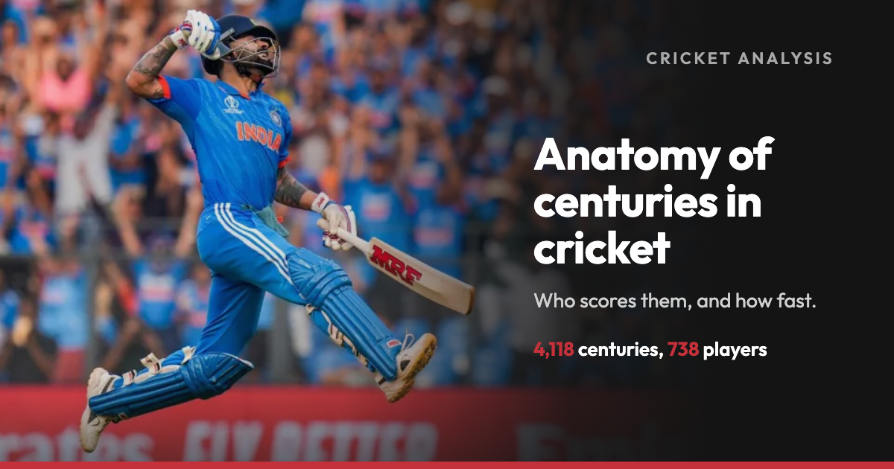
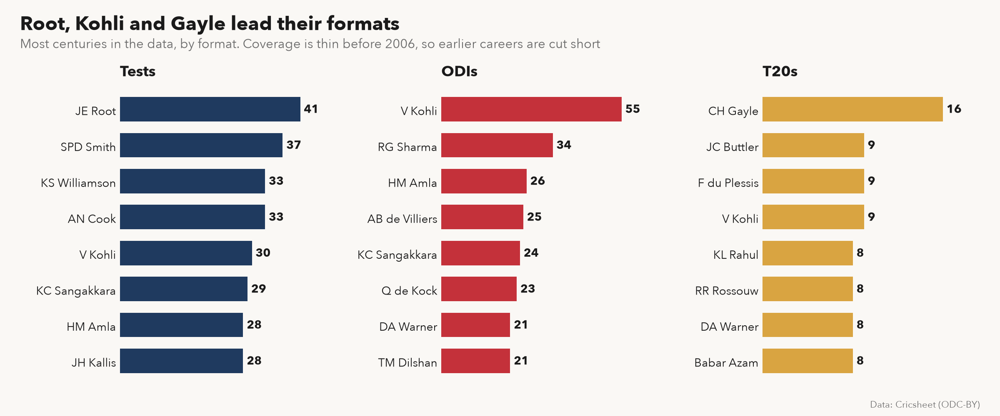
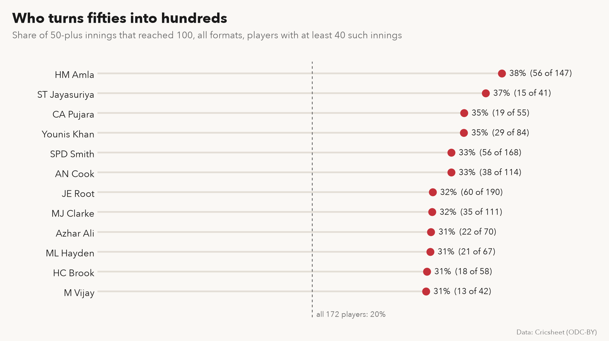
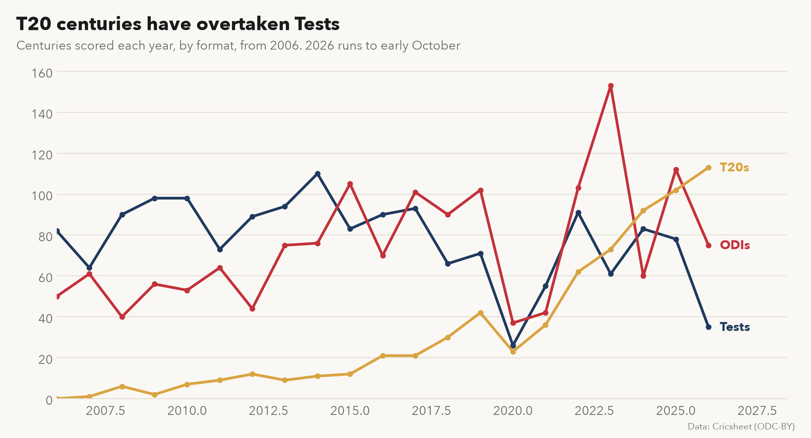
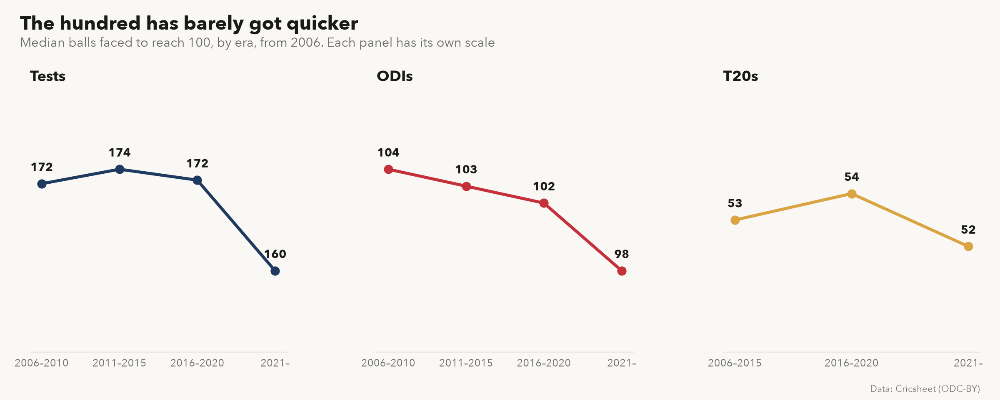
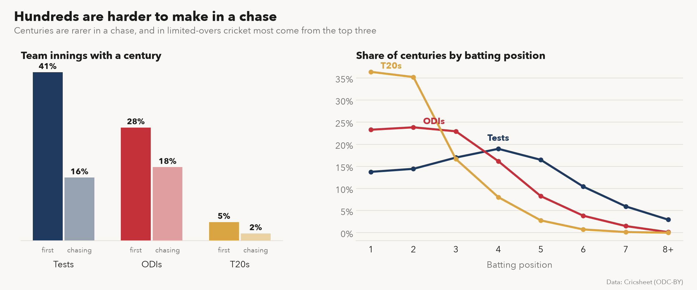
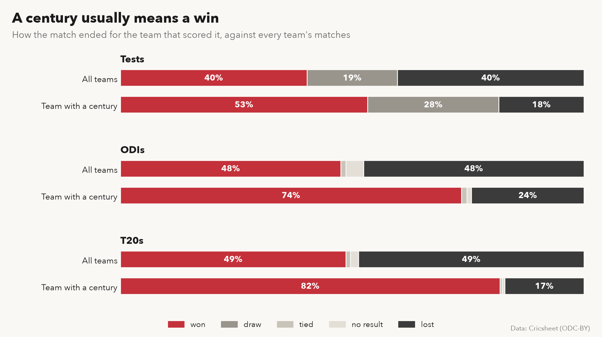
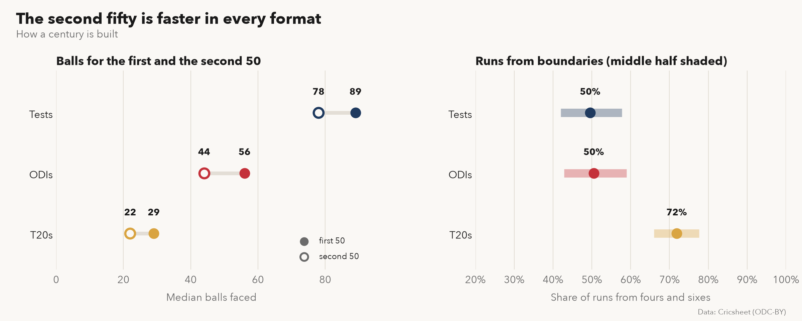

# Anatomy of centuries in cricket



## Overview

This project looks at every century in a ball-by-ball cricket dataset: 4,118 innings of 100 or more by 738 players in Tests, ODIs and T20s. It asks who scores them, how fast and when, and whether they win matches. A century is 100 or more runs off the bat in one innings, with Super Overs left out.

Cricsheet's coverage is thin before about 2006, so a career that started earlier is cut short. Tendulkar, Ponting and Lara do not appear in the lists below for that reason. The charts over time start in 2006, and the T20 lists include leagues as well as internationals.

## Who scores the centuries?



Root has the most Test centuries in the data (41), Kohli the most in ODIs (55) and Gayle the most in T20s (16). Kohli's ODI total is 21 ahead of the next batter, Rohit Sharma, the widest gap of the three lists.



Across the 172 players with at least 40 scores of 50 or more, one in five went on to 100. Amla converted the most often, 56 times in 147. Smith, Cook and Root all sit near one in three.

## Are centuries more common, and are they quicker?



T20 centuries went from single figures a year before 2012 to 113 in 2026, passing Test centuries in 2024. ODI centuries peaked at 153 in 2023, a World Cup year. Every format dipped in 2020. The 2026 figures run to early October.



The time to a hundred has hardly changed. The median ODI hundred took 104 balls in 2006 to 2010 and 98 since 2021. T20 hundreds stay near 53 balls. Test hundreds took about 172 balls until 2020 and 160 since.

## When in a match do centuries come?



A team batting first is far more likely to have a centurion than a team chasing: 41% against 16% in Tests, 28% against 18% in ODIs and 5% against 2% in T20s. In a Test the chase is the fourth innings. In T20s, 72% of centuries come from the two openers, and in ODIs 70% come from the top three. Test centuries peak at number four.

## Does a century win the match?



Teams with a centurion win far more often than teams in general: 74% against 48% in ODIs and 82% against 49% in T20s. In Tests the win rate rises from 40% to 53%, and draws rise too, from 19% to 28%, because a long innings uses up time. The two go together. The data does not show that the century caused the win, since a side that scores well is also more likely to have one.

## How is a century built?



The second fifty comes faster than the first in every format: 78 balls against 89 in Tests, 44 against 56 in ODIs and 22 against 29 in T20s. Boundaries carry about half the runs of a Test or ODI century and 72% of a T20 century.

## Data

The data is [The Ultimate Ball-by-Ball Cricket Dataset](https://github.com/ari-adaikalam/The-Ultimate-Ball-by-Ball-Cricket-Dataset) ([Kaggle](https://www.kaggle.com/datasets/ariadaikalam/the-ultimate-ball-by-ball-cricket-dataset)), built from [Cricsheet](https://cricsheet.org) under the [Open Data Commons Attribution License 1.0](https://opendatacommons.org/licenses/by/1-0/). Contains data from Cricsheet, used with attribution.

`build_centuries.py` turns it into four small tables in [data/](data), and the charts read only those. The fourth innings of a Test counts as a chase.

| File | Rows | Holds |
|---|---|---|
| `centuries.csv` | 4,118 | One row per century: player, date, opponent, batting position, runs, balls, balls to 50 and 100, boundaries, how the match ended |
| `player_format.csv` | 3,453 | Innings, fifties and hundreds for each player and format |
| `team_innings.csv` | 6 | Team innings batting first and chasing, and how many held a century |
| `team_results.csv` | 11 | How every team's matches ended |

## Run it yourself

```
pip install -r requirements.txt
python charts.py
```

The tables are in the repository, so the charts redraw as they are. To rebuild the tables, download the dataset and point the script at its folder:

```
python build_centuries.py --data <folder with ball_by_ball_data.csv, matches.csv, innings.csv and players.csv>
```

## License

The code is released under the MIT License, see the [LICENSE](LICENSE) file. The data keeps its own licence, above.

## Contact

Developed and maintained by Ari Adaikalam. [Portfolio](https://ariadaikalam.com) | [Email](mailto:ariadaikalam1234@gmail.com)
